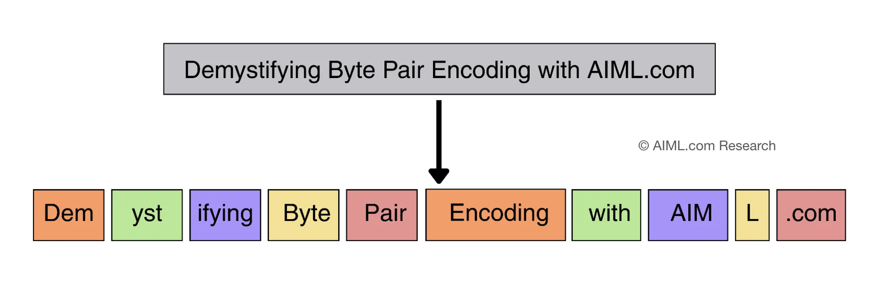

## Basics of Natural Language Processing

This is probably the start of a series of articles about the basics of NLP. This clearly doesn't belong to my [tech blog](https://snaveenmathew.github.io/tech_non_tech_blog/) because this series will go through topics in detail, sometimes to an annoying degree, because the objective is not only to communicate what I know, but also to challenge my fundamental understanding - with the advent of LLMs, nowadays people don't care about those topics.

### What is Language?

Language can be defined as a structured system that uses signs, such as words or gestures, to express ideas and coordinate behavior. Natural languages are the languages people acquire and use for everyday communication, including spoken, signed, and written forms. This is a functional definition rather than a definition based on a particular grammar or writing system.

Merriam-Webster defines [natural language](https://www.merriam-webster.com/dictionary/natural%20language) as 'a language (such as English, Spanish, or Samoan) that is the native speech of a people'. It's a very loose definition - imagine asking someone to define a 'fruit' and getting the answer "it's something like apples, oranges, bananas, etc.". [Wikipedia's definition](https://en.wikipedia.org/wiki/Natural_language) is more rigid - we will use it from now on.

### Why do we need language?

Language enables people to represent and exchange ideas efficiently. It also lets a reader or listener construct meaning from context rather than receiving only a direct sensory or physical message. Symbols are shared socially: the same word can identify a common object or concept while still acquiring different interpretations in different contexts.

The historical claim that one communication method was replaced by another is difficult to establish directly, and archaeological evidence does not support a simple chronological replacement of drawing by language. We can therefore make a narrower, non-historical observation: language is reusable and compositional, so a relatively small set of symbols can describe many situations. [This article](https://news.stanford.edu/stories/2019/08/the-power-of-language-how-words-shape-people-culture) covers research and proposals about how language shapes people and culture.

### What are words?

#### Definition

Merriam-Webster defines [word](https://www.merriam-webster.com/dictionary/word) as a speech sound or series of speech sounds that symbolizes and communicates a meaning usually without being divisible into smaller units **capable of independent use**.

#### Implementation and standardization

A string can be used to represent each document in almost every programming language. Strings are a sequence of characters (smallest units corresponding to a length of 1) with each character having an underlying integer value to represent it (eg: 'a' = 97 and 'A' = 65 in ASCII; ASCII is just one of many standard character encodings).

A 'token' typically refers to a word. Typical 'word tokenization' is performed using simple rules, such as splitting on spaces and punctuation. Language processing models then 'represent' words as vectors of numbers (see the next section) to perform their tasks.

```text
lowercase(char):
  int_char = int(char)
  if int_char >= 65 and int_char <= 90:
    return chr(int_char + 32)
  return char

lower_document(document):
  lower_result = ''
  for i, char in enumerate(document):
    lower_result = concat(lower_result, lowercase(char))
  return lower_result

tokenize(document):
  delimiters = set(' ', '.', '?', '!', ',', '\t', '\n', '\r', '(', ')', '[', ']', '{', '}', '"', '\'', '\\')
  tokenized = empty list
  current_token = empty string

  for char in lower_document(document):
    if char in delimiters:
      if current_token != '':
        tokenized.append(current_token)
      current_token = ''
    else:
      current_token += char

  if current_token != '':
    tokenized.append(current_token)

  return tokenized
```

#### Caveats

Tokens aren't always words. A token might be a single character (applicable to only a small subset of language models), a contraction (eg: "don't") or a part of a word (eg: "n't"). Modern 'generative models' (Gemini / ChatGPT / Claude) use the same 'subword tokenization' approach, but they [use different underlying algorithms, custom vocabularies and merge rules](https://www.cio.com/article/4156783/understanding-tokenization-and-consumption-in-llms.html). Modern tokenization looks more like the image in [this article](https://aiml.com/demystifying-byte-pair-encoding-bpe/).

Apart from BPE tokenization, there were a few rule / model based standardization / normalization steps: spell checking, stemming, lemmatization, etc. These are not covered here.



### The representation problem and Bag of Words (BoW)

Computers do not inherently represent or process language as people do. They operate on numbers, so natural language must first be converted into a representation that can be used for computation/calculation. This 'representation'/translation/conversion does not by itself give a computer the human meaning of a sentence. Models are trained to map representations to outputs; "understanding" is therefore context-dependent and may mean something very different from human comprehension.

One of the earliest representations counted how often terms occur in a document. This is called the [Bag of Words](https://en.wikipedia.org/wiki/Bag-of-words_model) (BoW) representation. In count-based BoW, the vocabulary is the set of distinct terms and each document is represented as a vector of term frequencies. Binary BoW instead records only whether each term occurs. Both forms ignore term order.

Before constructing BoW, we choose a preprocessing pipeline. For the following example and pseudocode, we use a consistent pipeline:

1. Read and normalize text, such as converting Unicode consistently and lower-casing if case distinctions are not needed.
2. Split text on whitespace and the selected punctuation using a specified tokenizer. In this article, punctuation acts as a delimiter and is not included as a token.
3. If punctuation should be meaningful for the task, use a tokenizer that keeps it instead.
4. Optionally remove a fixed stop-word list or apply stemming or lemmatization.

These decisions are part of the model specification and must remain fixed after they are chosen. For example:

```text
Corpus:
  document 1: "NLP uses language."
  document 2: "Language enables communication."

After lower-casing and splitting:
  document 1: ["nlp", "uses", "language"]
  document 2: ["language", "enables", "communication"]

Vocabulary: ["nlp", "uses", "language", "enables", "communication"]

Count-based DTM:
  [1, 1, 1, 0, 0]
  [0, 0, 1, 1, 1]

Binary DTM:
  [1, 1, 1, 0, 0]
  [0, 0, 1, 1, 1]
```

For this example the matrices happen to have the same values because no term repeats. Longer documents can differ.

$$vocab = set(distinct\_words) = \{w_1, w_2, ..., w_n\}$$

$$X_{\mathrm{DTM},(i,j)} = \sum_{k=1}^{|\mathrm{document}_{i}|} 1(\mathrm{document}_{i}[k] = \mathrm{vocab}_{j})$$

#### Implementation

```text
fit_vocabulary(documents):
  term_column_map = empty hash map

  for document in documents:
    for word in tokenize(document):
      if word not in term_column_map:
        term_column_map[word] = size(term_column_map)

  return term_column_map

build_sparse_dtm(documents, term_column_map):
  sparse_rows = empty list

  for document in documents:
    document_term_count = empty hash map

    for word in tokenize(document):
      if word not in term_column_map:
        continue
      column_index = term_column_map[word]

      if column_index not in document_term_count:
        document_term_count[column_index] = 0
      document_term_count[column_index] += 1

    append document_term_count to sparse_rows

  return sparse_rows
```

`sparse_rows[i]` is a map from column index to count for document $i$. A zero count does not need to be stored. To fit and transform a dataset correctly, fit `term_column_map` only on training documents and then call `build_sparse_dtm` for training and test documents with the same map.

The pseudocode assumes average constant-time hash-map operations. This is the usual hash-map assumption, but worst-case and library-dependent behavior can differ.

#### Complexity

##### Time complexity

Let:

- $N$ be the number of documents,
- $V$ be the vocabulary size,
- $T = \sum_{i=1}^{N} t_i$ be the total number of tokens across all documents, where $t_i$ is the number of tokens in document $i$, and
- $N_0$ be the number of nonzero entries in the DTM.

- Building the vocabulary: $O(T)$ on average
- Building sparse document rows: $O(T)$ on average
- Initializing a dense DTM: $O(NV)$
- Filling a dense DTM from sparse rows: $O(N_0)$

The sparse implementation has a total expected time of $O(T)$, assuming average constant-time hash-map operations. If a dense DTM is also needed, its construction additionally requires $O(NV)$ initialization and $O(N_0)$ filling from the sparse rows. Its total construction time is $O(T + NV)$ because $N_0 \leq T$.

Since each document has at most $T$ term occurrences, $N_0 \leq \min(NV,T)$.

##### Space complexity

- Dense DTM: $O(V + NV)$
- Sparse DTM represented by hash-map rows: $O(V + N + N_0)$
- Sparse CSR-style DTM: $O(V + N + N_0)$

The dense representation stores $NV$ matrix entries, even when many are zero. The sparse representation stores the vocabulary and the $N_0$ nonzero entries. It also needs $N$ row structures or row offsets: $N$ hash maps for the row-map representation, or $N+1$ offsets for CSR. For simplicity, both are written as $O(V + N + N_0)$.

### How's BoW used in practice?

Let's assume we have a corpus of documents for a specific task such as sentiment analysis. We want to train a classifier that can predict the sentiment of a given document. The model will be of the form $Y = f(X_{DTM})$ for which the in-sample fit will be $\hat{y} = \hat{f}(X_{DTM})$. This learned model links the counts of words in a document with the sentiment of that document.

Interpretation varies with the model architecture. For a simple linear 'classifier', $\hat{y} = \hat{f}(X_{DTM}) = \hat{w}^T X_{DTM}$, and $w_i$ describes the learned association of term $i$ with the output. A positive or negative coefficient can be treated as a positive or negative association between the word and sentiment.

Assumptions and caveats: For simplicity, we assume simple linear model with a fixed + convex loss function (eg: cross-entropy) without regularization. Similar terms (VIF), document length and class balance can all affect the stability of learned coefficients. For a valid evaluation, split the documents into training and test sets before fitting - fit preprocessing statistics and the vocabulary on the training set only. Transform the test documents with that fixed vocabulary and exclude words in the test set that were not observed in the train set (more recent methods use 'UNK' tokens).

### This is too old. Why bother?

The answer is simple: computation is not free. Many modern models still use tokenization and other preprocessing, so the input representation can add both memory and energy costs. The fact that these steps are almost instantaneous today does not remove their computational requirements. Tokenizer-free approaches also exist, but they convert or process raw text at another stage of the model rather than eliminating computation.

**Note:** In a [previous LinkedIn post](https://www.linkedin.com/posts/snaveenmathew_the-first-two-lines-of-the-paper-resonated-share-7464040800893648896-Zhm2/?utm_source=share&utm_medium=member_desktop&rcm=ACoAAAQW-0oB2j2VSm47oqBjlGu8flMcnAIJhDw) I speculated tokenization may not be required in the future. Recently Aleksa Gordic shared [H-Nets](https://www.cartesia.ai/blog/from-tokens-to-bytes-part-1) - a class of tokenizer-free models. **Opinion:** This is not just a step towards reducing computation and energy usage; it is a tangible step towards improving the quality of language models.

### What's next?

1. For now I will focus on theory + pseudo code + use of some libraries or frameworks if required. Next topic: word embeddings.
2. At a later point, I will be implementing everything from scratch using almost no libraries or frameworks. Target: C++ for DTM, base Python + numpy for a few scenarios, Tensorflow/PyTorch only if required.

### Sources and inspirations

- [Introductory Natural Language Processing on Kaggle](https://www.kaggle.com/learn-guide/intro-nlp)
- [Intermediate Natural Language Processing on Kaggle](https://www.kaggle.com/learn-guide/intermediate-nlp)

Content is likely to lag behind the courses I completed. Code will be shared in [this repo](https://github.com/SNaveenMathew/zero_to_karpathy) moving forward - it's currently empty and will be populated soon.
